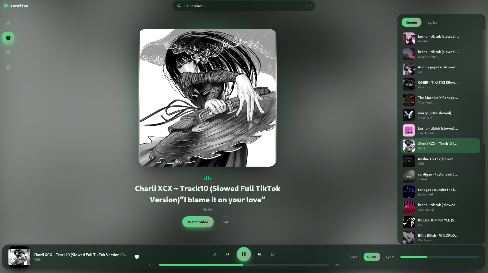

# Senritsu



Customizable, ad-free native music client for Linux built with Rust and Tauri v2.

[Features](#features) • [Tech Stack](#tech-stack) • [Installation](#prerequisites--installation) • [Development](#development) • [Troubleshooting](#troubleshooting) • [References](#references) • [License](#license)

---

**Senritsu** is a lightweight, highly customizable desktop music player engineered specifically for Linux systems. By leveraging Tauri v2 and Rust, Senritsu delivers modern UI responsiveness without the heavy memory footprint of Electron frameworks. Audio streams are rendered directly through mpv while media discovery is powered by yt-dlp, eliminating web player tracking, bloat, and audio ads entirely.

---

## Features

- **Zero Ads:** Direct stream extraction via yt-dlp bypasses YouTube web players and audio advertising.
- **Smart Queueing:** Full queue controls, liked tracks collection, and automatic radio playback continuation when your queue ends.
- **Synchronized Lyrics:** Dynamic lyrics auto-synced directly from LRCLIB.
- **Deep UI Customization:** 7 built-in themes, accent color pickers, adjustable corner radii, and dynamic blurred cover artwork glows.
- **Native Desktop Integration:** System tray support, close-to-tray capability, and global X11 media key shortcuts.
- **Keyboard-Driven Navigation:** Fast controls including Space for play/pause and slash to focus the search bar immediately.

---

## Tech Stack

| Component | Technology | Description |
|---|---|---|
| Core and Engine | Rust | Multi-threaded backend architecture |
| GUI Framework | Tauri v2 | Native WebKit runtime with zero-Electron overhead |
| Audio Engine | mpv | High-performance open-source media player |
| Stream Extraction | yt-dlp | Command-line audio stream extractor |
| Lyrics Provider | LRCLIB | Community-driven synchronized lyrics API |

---

## Prerequisites & Installation

Execute the provided automated initialization script to prepare system libraries, Rust toolchains, mpv, yt-dlp, and the Tauri CLI:

```bash
# Clone repository
git clone [https://github.com/Imainigination/Senritsu.git](https://github.com/Imainigination/Senritsu.git)
cd Senritsu

# Make script executable and run dependency setup
chmod +x install-deps.sh
./install-deps.sh

```

## Development

Run the client in interactive development mode with hot reloading:

```bash
cargo tauri dev
```

To compile production binary packages, run the build command. 
The generated .deb and .AppImage bundles will be placed in the target release directory:

```bash
cargo tauri build
```

## Troubleshooting

- **Search fails or audio will not stream:** Ensure `yt-dlp` is on the latest release via `yt-dlp -U` and confirm `~/.local/bin` is exported in your environment `PATH`.
- **Could not start mpv Error:** Verify `mpv` is installed and accessible via system path using `which mpv`.
- **Blank window on NVIDIA drivers:** Senritsu explicitly sets `WEBKIT_DISABLE_DMABUF_RENDERER=1` to prevent hardware DMA buffer rendering failures on WebKitGTK.

---

## References

- [Tauri v2 Documentation](https://v2.tauri.app/)
- [Rust Programming Language Docs](https://doc.rust-lang.org/book/)
- [mpv Player Reference Manual](https://mpv.io/manual/master/)
- [yt-dlp Documentation](https://github.com/yt-dlp/yt-dlp#readme)
- [LRCLIB API Docs](https://lrclib.net/docs)

---

## License

This project is licensed under the MIT License.
